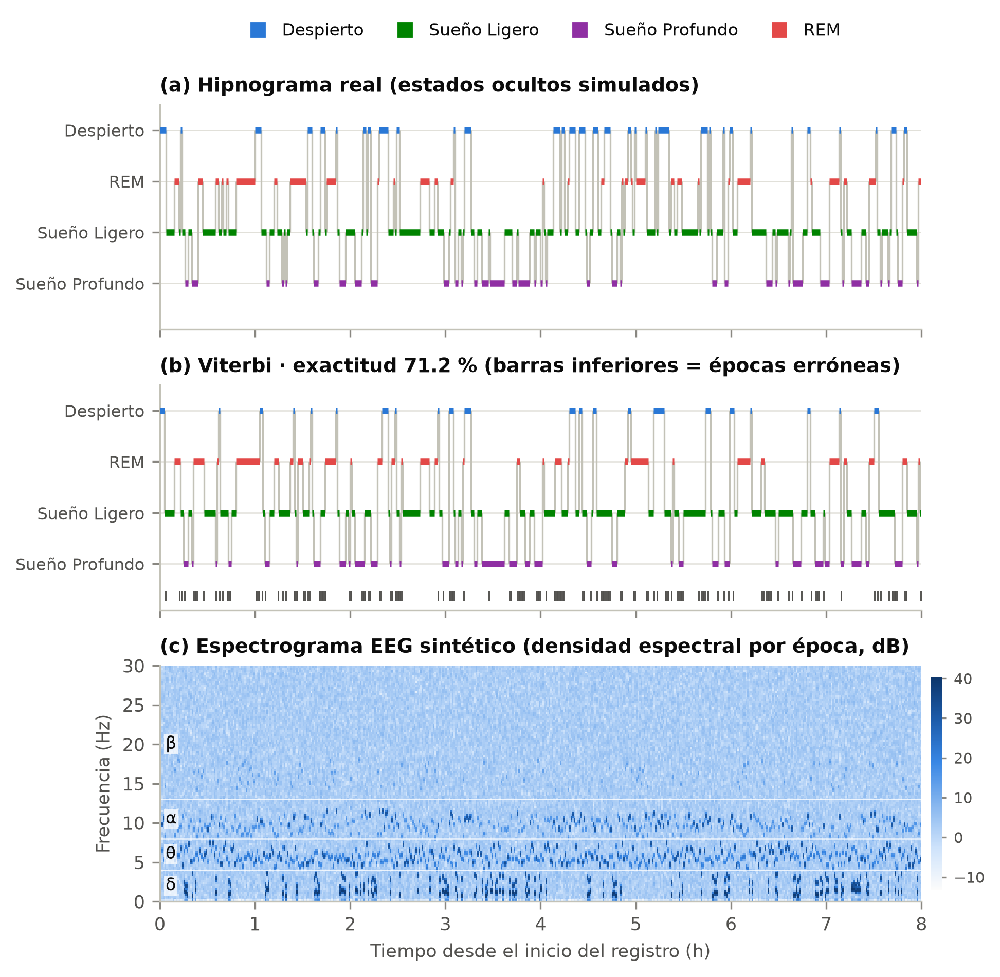
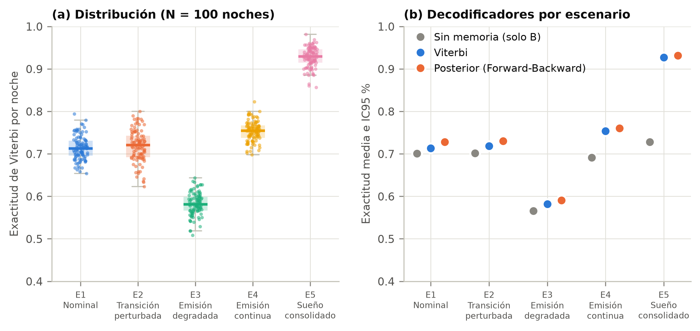
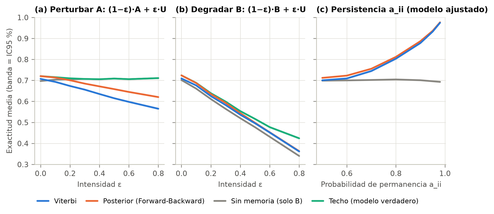

# Estadificación del sueño (polisomnografía) con Modelos Ocultos de Markov

Simulación Monte Carlo de un **HMM de cuatro estados** (Despierto, Sueño Ligero, Sueño Profundo, REM) que se
observa a través de cuatro rasgos de EEG/EOG por época (ondas alfa, theta, delta y movimientos oculares rápidos).
El proyecto implementa Forward-Backward, Viterbi y Baum-Welch desde cero (NumPy), los valida frente a la
enumeración exhaustiva y a `hmmlearn`, y evalúa el modelo con réplicas independientes, intervalos de confianza,
análisis de sensibilidad y comprobaciones de reproducibilidad. Incluye las tablas y figuras generadas por código
y las diapositivas del video pitch.

> **Alcance y uso responsable.** Es un estudio de **simulación** con parámetros didácticos del enunciado de la
> actividad. No usa registros de pacientes y sus informes "clínicos" son educativos: **no constituyen
> diagnóstico médico**.

## Resultados clave (semilla maestra 42, 100 noches de 480 épocas por escenario)

| Escenario | Exactitud Viterbi (media, IC95 %) | Sin memoria | κ de Cohen |
|---|---|---|---|
| E1 Nominal (matrices del enunciado) | 71.4 % (70.8–71.9) | 70.1 % | 0.588 |
| E2 Transición perturbada | 71.8 % | 70.2 % | 0.587 |
| E3 Emisión degradada | 58.2 % | 56.6 % | 0.404 |
| E4 Emisión continua (Gauss × Poisson) | 75.3 % | 69.1 % | 0.645 |
| E5 Sueño consolidado (más persistencia) | 92.7 % | 72.8 % | 0.881 |

* El valor del contexto temporal depende de la **persistencia** de las etapas: Viterbi supera al clasificador sin
  memoria en 1.3 puntos con las matrices nominales y en 19.9 con el escenario consolidado.
* Degradar la matriz de emisión **B** reduce el techo del propio modelo verdadero (pérdida de información);
  perturbar la transición **A** solo penaliza al decodificador desajustado (desajuste del modelo).
* La media entre 20 semillas maestras varía con DE = 0.0029 (error estándar teórico ≈ 0.0026, consistente) y dos ejecuciones
  independientes producen CSV con **sumas SHA-256 idénticas**.
* Baum-Welch con inicialización aleatoria es poco fiable (62.1 % de exactitud en prueba con 20 noches); con una
  inicialización informada llega a 69.7 % (modelo verdadero: 71.1 %).
* El Viterbi en dominio lineal (listado de la plantilla del curso) hace *underflow* en el 84 % de las noches de
  480 épocas; aquí se usa log-espacio.

| Hipnograma real vs Viterbi | Escenarios y decodificadores |
|---|---|
|  |  |



## Estructura del repositorio

```
Polisomnografia/
├── README.md                  este archivo
├── main_simulation.py         ejecuta todo el estudio (CSV, figuras, informes, tablas LaTeX)
├── requirements.txt           versiones exactas usadas (Python 3.13.14)
├── requirements-dev.txt       + pytest
├── pytest.ini
├── src/
│   ├── hmm_core.py            clase HMM: simulación, Forward-Backward escalado, Viterbi (log), Baum-Welch
│   ├── emissions.py           emisiones: categórica, gaussiana, Poisson y producto de bloques
│   ├── sleep_model.py         π, A, B del enunciado y transformaciones (perturbación, persistencia, patologías)
│   ├── eeg_signals.py         señales EEG/EOG sintéticas y extracción de símbolos
│   ├── clinical.py            métricas clínicas del hipnograma e informe simulado
│   ├── utils_stats.py         κ, F1, IC95 (t y bootstrap), Welch, Mann-Whitney, Holm, AUC
│   ├── experiments.py         escenarios, sensibilidad, Baum-Welch, patologías, validación
│   ├── plotting.py            figuras PNG de 300 dpi
│   └── latex_export.py        tablas y macros de LaTeX generadas desde results/
├── tests/                     36 pruebas (núcleo HMM, modelo, experimentos, consistencia del manuscrito)
├── results/                   CSV crudos y resumidos, informes, environment.json, SHA256SUMS.txt
├── paper/                     figures/ (PNG 300 dpi) y auto/ (tablas y macros de LaTeX generadas)
└── video/                     diapositivas del pitch
```

## Instalación y ejecución

```bash
python -m venv .venv
.venv\Scripts\activate            # Windows  (Linux/macOS: source .venv/bin/activate)
pip install -r requirements.txt
```

```bash
python main_simulation.py          # estudio completo: ≈ 5–7 min
```

```bash
python main_simulation.py --quick  # versión reducida para verificar la instalación: ≈ 1 min
```

```bash
python -m pip install -r requirements-dev.txt
python -m pytest                   # 36 pruebas
```

Opciones: `--seed N` (otra semilla maestra), `--reps N` (noches por escenario), `--no-figures` (solo CSV),
`--outdir` y `--figdir`.

## Reproducibilidad

* **Semillas.** Una semilla maestra (42) genera, con `numpy.random.SeedSequence.spawn`, una semilla hija
  **independiente** por réplica y experimento: no se repite la misma semilla y añadir réplicas no cambia las
  anteriores.
* **Entorno.** `results/environment.json` registra las versiones; `requirements.txt` las fija.
* **Verificación bit a bit.** `results/SHA256SUMS.txt` contiene las sumas de los CSV, informes y
  `resumen_clave.json`. Para comprobarlo en su equipo:

```bash
python main_simulation.py --no-figures --outdir otra_ejecucion
fc results\SHA256SUMS.txt otra_ejecucion\SHA256SUMS.txt     # Linux/macOS: diff
```

  La igualdad bit a bit se verificó en el entorno indicado; otras versiones de NumPy/SciPy o de sistema
  operativo pueden cambiar los últimos dígitos.
* **Validación del código.** Forward, Viterbi y posteriores coinciden con la enumeración exhaustiva de todas las
  trayectorias y con `hmmlearn`; la log-verosimilitud de Baum-Welch no decrece; se conservan los ceros
  estructurales; el simulador converge a la matriz teórica con pendiente −1/2 en escala log-log.

## Modelo

`λ = (S, V, A, B, π)` con N = 4 estados y M = 4 símbolos; época = 1 min, noche = 480 épocas. Las matrices vienen
del enunciado (ver `src/sleep_model.py` y la Sección 4 del artículo). Cada fila de A y de B suma 1, y el cero
`A[REM → Profundo] = 0` impide pasar de REM directamente a sueño profundo.

## Cumplimiento de la actividad

| Requisito | Dónde está la evidencia |
|---|---|
| Problema, justificación y preguntas P1–P3 | Artículo, Secciones 1 y 7 |
| ≥ 10 referencias de los últimos 5 años (IEEE) | 18 recientes + 8 clásicas + 3 de software; bibliografía del artículo (entregado aparte) |
| Notación formal (S, V, A, B, π), propiedad de Markov, distribuciones | Artículo, Secciones 3 y 4; `src/sleep_model.py` |
| Implementación documentada, ejecutable y reproducible | `src/`, `main_simulation.py`, `tests/`, `README.md` |
| ≥ 3 escenarios con media, DE, mín, máx e IC95 % | `results/escenarios_resumen.csv` (5 escenarios), Tabla 4 del artículo |
| ≥ 1 tabla y 2 figuras de calidad publicable (300 dpi) | `paper/figures/` (12 figuras), tablas en `paper/auto/` |
| Semillas fijas y entorno documentado | `results/environment.json`, `SHA256SUMS.txt` |
| Hipnograma, señales EEG simuladas, métricas clínicas, Viterbi, alteraciones, informe, heatmap de A | `paper/figures/fig03`–`fig05` y `fig11`, `results/informes/`, `results/patologias_*.csv` |
| Video pitch de 2–3 min | `video/` (diapositivas; el MP4 debe grabarse) |
| Antiplagio | Debe ejecutarlo el equipo con la herramienta de la institución |

## Limitaciones

Estudio de simulación con parámetros didácticos (no ajustados a datos); duraciones geométricas de las etapas y
épocas de un minuto; símbolos discretizados y señales generadas desde ellos; sin validación con PSG real
(trabajo futuro: Sleep-EDF); Baum-Welch con identificabilidad débil. Detalles en la Sección 6 del artículo.

## Licencia

Sin licencia para uso ni distribución. Este repositorio se creó únicamente para presentar una actividad de la
asignatura Simulación de la Institución Universitaria Digital de Antioquia.
